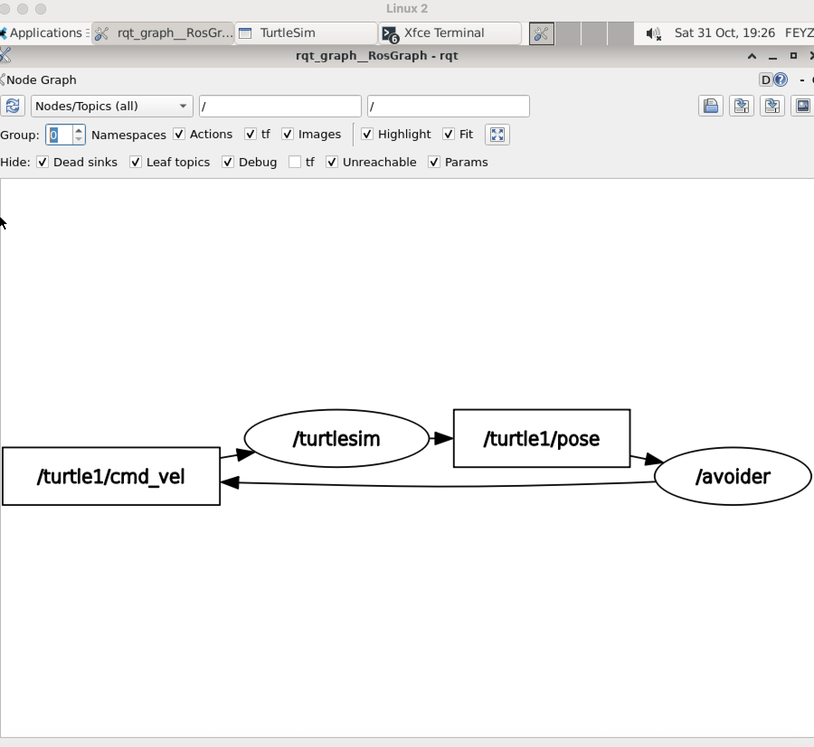

# turtle_avoider

ROS 2 Humble ile yazılmış, turtlesim üzerinde çalışan engelden kaçınma projesi.

Bir kaplumbağa (`turtle1`) düz ilerler. Duvara ya da haritada daire çizen ikinci kaplumbağaya (`turtle2`) yaklaştığında yön değiştirip uzaklaşır.

## Node mimarisi



| Node | Abone olduğu topic | Yayınladığı topic |
|---|---|---|
| /avoider | /turtle1/pose, /turtle2/pose | /turtle1/cmd_vel |
| /wanderer | - | /turtle2/cmd_vel |
| /turtlesim | /turtle1/cmd_vel, /turtle2/cmd_vel | /turtle1/pose, /turtle2/pose |

`/wanderer` açılışta `/spawn` servisini çağırarak `turtle2`'yi oluşturur ve sürekli daire çizdirir. `/avoider` ise 10 Hz'lik bir zamanlayıcı döngüsünde iki konumu okur ve karar verir. Öncelik sırası: duvar, diğer kaplumbağa, düz ilerleme. Yön hatası oransal (P) kontrolle düzeltilir.

## Parametreler

| Parametre | Varsayılan | Açıklama |
|---|---|---|
| wall_margin | 1.5 | Duvara bu mesafeden fazla yaklaşınca kaçar |
| obstacle_distance | 2.0 | Diğer kaplumbağaya bu mesafeden fazla yaklaşınca kaçar |
| cruise_speed | 2.0 | Düz ilerlerken ileri hız |
| turn_gain | 3.0 | Dönüşteki P kontrol kazancı |
| center_x, center_y | 5.5 | Duvardan sonra dönülen hedef nokta |

Parametreler node çalışırken değiştirilebilir:

```bash
ros2 param set /avoider wall_margin 2.5
ros2 param set /avoider cruise_speed 4.0
```

## Kurulum ve çalıştırma

Ubuntu 22.04 + ROS 2 Humble gerekir.

```bash
mkdir -p ~/ros2_ws/src
cd ~/ros2_ws/src
git clone https://github.com/feyza-dogmus/turtle_avoider.git turtle_avoider
cd ~/ros2_ws
colcon build --packages-select turtle_avoider
source install/setup.bash
```

Tek komutla her şeyi başlatmak için (turtlesim, wanderer ve avoider birlikte açılır):

```bash
ros2 launch turtle_avoider avoider.launch.py
```

## Geliştirme notları

- İlk sürümde komut yalnızca pose mesajı gelince üretiliyordu. Kaplumbağa durduğu için pose gelmiyor, komut da çıkmıyordu. Kontrol, zamanlayıcıya bağlı bir döngüye taşınarak çözüldü.
- İlk kaçınma mantığı duvar bölgesinde dönerken ileri gittiği için dar ilmeklerde sıkışıyordu. Şimdi önce hedefe dönüyor, yön tutunca ilerliyor.
- Aynı node iki kez çalıştırılınca iki kaynak aynı topic'e yayın yaptı. `ros2 node list` ile tespit edildi. Launch dosyası bu hatayı bir daha yaşamamak için eklendi.
- Kaplumbağa yerinde dönerken engel hareket etmeye devam ettiği için mesafe bazen eşiğin altına düşebiliyor. Daha erken tepki için `obstacle_distance` artırılabilir.

## Yol haritası

- Birden fazla engel
- TurtleBot3 + Gazebo + LiDAR ile engelden kaçınma

## Not

Kod yazımında yapay zekâdan yardım aldım. Kodu çalıştırıp hataları (pose gelmeyince komutun çıkmaması, iki node çakışması) kendim tespit ettim ve düzelttim.

Yazar: Feyza Doğmuş
